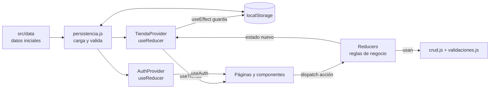
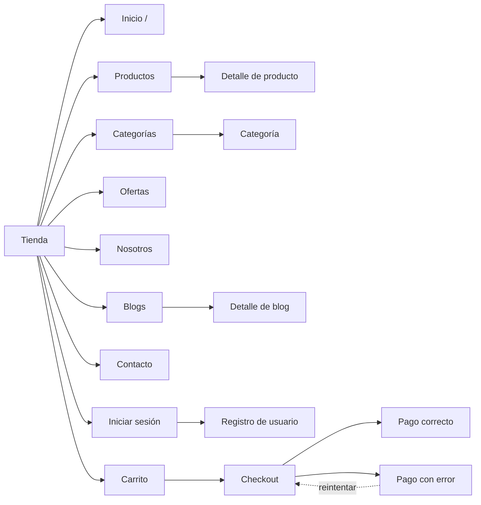
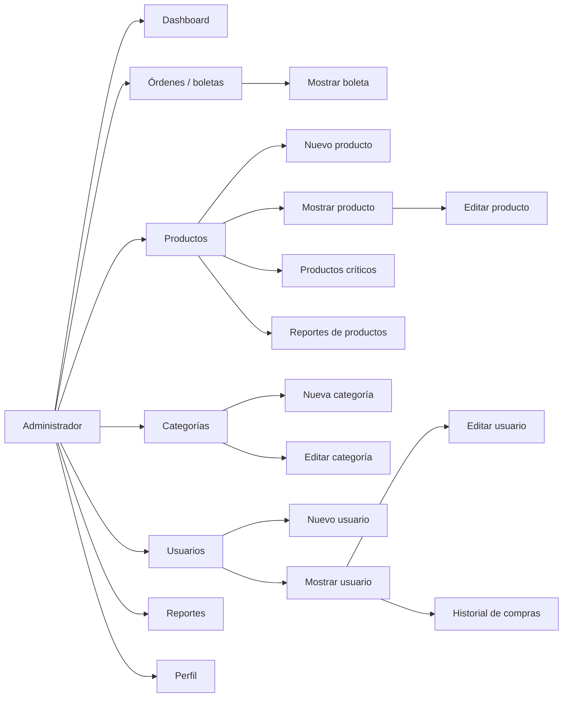
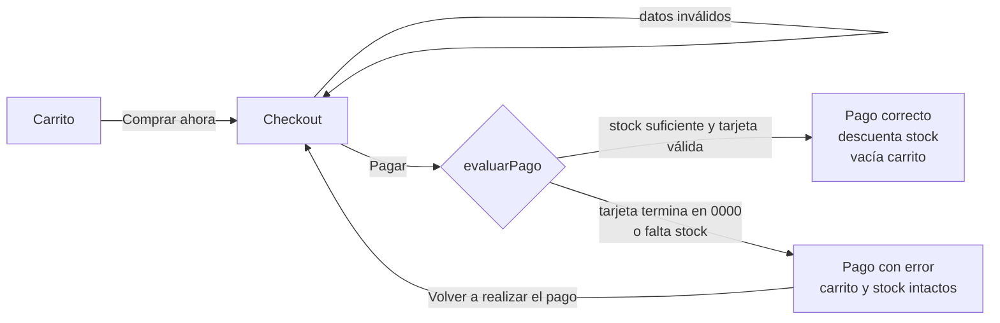
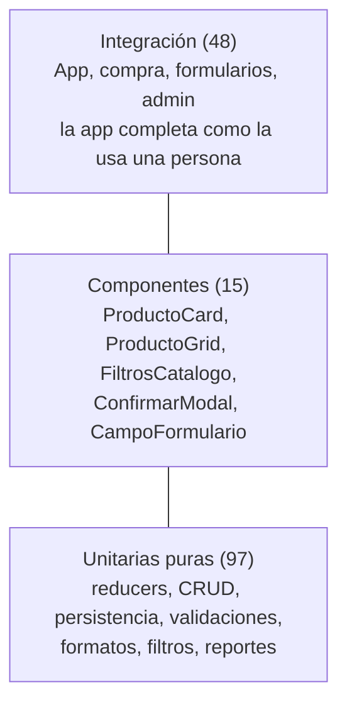

# NexusTech: documentación completa del proyecto

> **Asignatura:** Desarrollo Fullstack II · **Evaluación 2** (30 %)
> **Equipo:** Cristóbal Stenger y Xavier Marin
> **Repositorio:** `CristobalStenger/fullstack.code`

Este documento explica todo el proyecto NexusTech, con tres focos:

1. **La migración** desde HTML, CSS y JavaScript "vanilla" (entrega 1) a **React + Vite** (entrega 2).
2. **Las funciones y pestañas nuevas** que pide la Evaluación 2: categorías, ofertas, checkout,
   pago exitoso y con error, y el panel de administración completo.
3. **Las pruebas unitarias**: cómo están configuradas, qué verifican y cuánto código cubren.

---

## Índice

1. [Resumen del proyecto](#1-resumen-del-proyecto)
2. [Cómo ejecutar el proyecto](#2-cómo-ejecutar-el-proyecto)
3. [Punto de partida: la entrega 1 en HTML, CSS y JS](#3-punto-de-partida-la-entrega-1-en-html-css-y-js)
4. [La migración a React + Vite](#4-la-migración-a-react--vite)
   - [4.5 Guía de componentes de React](#45-guía-de-componentes-de-react)
5. [Funciones nuevas y pestañas](#5-funciones-nuevas-y-pestañas)
6. [Pruebas unitarias](#6-pruebas-unitarias)
7. [Verificación manual](#7-verificación-manual)
8. [Limitaciones y trabajo futuro](#8-limitaciones-y-trabajo-futuro)
9. [Preguntas frecuentes para la defensa](#9-preguntas-frecuentes-para-la-defensa)

---

## 1. Resumen del proyecto

**NexusTech** es una tienda en línea chilena de tecnología: componentes de PC, periféricos,
consolas y notebooks. La entrega 1 era un sitio de páginas HTML estáticas con lógica en
JavaScript. En la entrega 2 se convirtió en una **aplicación de una sola página (SPA)** hecha con
React y se agregaron nuevos flujos de compra y administración.

### Las dos entregas dentro del repositorio

| Entrega      | Carpeta                                          | Tecnologías                                               |
| ------------ | ------------------------------------------------ | --------------------------------------------------------- |
| Evaluación 1 | Raíz (`index.html`, `css/`, `js/`, `admin/`…)    | HTML5, CSS3, Bootstrap 5 (CDN), JavaScript                |
| Evaluación 2 | [`nexustech-react/`](nexustech-react/)           | React 19, Vite 7, React Router 7, React Bootstrap, Vitest |

Los archivos de la entrega 1 se conservaron sin cambios como referencia. La versión React vive en
su propia carpeta, igual que el proyecto de ejemplo de la guía del curso.

### Tecnologías de la entrega 2

| Herramienta                       | Para qué se usa                                                                   |
| --------------------------------- | --------------------------------------------------------------------------------- |
| **React 19**                      | Construir la interfaz con componentes reutilizables y estado                      |
| **Vite 7**                        | Servidor de desarrollo con recarga instantánea y compilación de producción        |
| **React Router 7** (declarativo)  | Navegación entre pestañas sin recargar la página (`/productos`, `/admin`…)        |
| **React Bootstrap 2 + Bootstrap 5** | Diseño responsivo con componentes React (Navbar, Modal, Carousel, Toast, Form…) |
| **Bootstrap Icons**               | Íconos de la interfaz                                                             |
| **Context + useReducer**          | Estado global de la tienda y de la sesión                                         |
| **localStorage**                  | Persistencia de productos, carrito, usuarios, órdenes y sesión                    |
| **Vitest 4 + Testing Library**    | Pruebas unitarias, de componentes y de integración                                |
| **ESLint**                        | Revisión automática de calidad del código                                         |

### Estado actual

| Comprobación              | Resultado                                         |
| ------------------------- | ------------------------------------------------- |
| Pruebas automatizadas     | **160 aprobadas** en 17 archivos                  |
| Cobertura de líneas       | **96,99 %**                                       |
| Cobertura de ramas        | **92,21 %**                                       |
| ESLint                    | Sin errores ni advertencias                       |
| Compilación (`npm run build`) | Aprobada                                      |

### Cifras de la migración

| Medida                        | Entrega 1 (HTML/JS)                 | Entrega 2 (React)                                  |
| ----------------------------- | ----------------------------------- | -------------------------------------------------- |
| Páginas o vistas              | 21 archivos HTML                    | 35 páginas (16 de tienda + 19 de administración)    |
| Archivos de lógica            | 7 archivos JS (≈2.270 líneas)       | 101 módulos JS/JSX (≈6.550 líneas, incluye datos)  |
| Componentes reutilizables     | 0 (cabecera y pie copiados 21 veces) | 37 componentes + 5 hooks propios                   |
| Pruebas automatizadas         | 0                                   | 160 (≈1.700 líneas)                                |

---

## 2. Cómo ejecutar el proyecto

Requisito: **Node.js 20.19 o superior** (comprueba con `node -v`).

```bash
cd nexustech-react
npm ci          # instala las versiones exactas guardadas en package-lock.json
npm run dev     # abre http://localhost:5173
```

> **En Windows (PowerShell):** si la ruta tiene espacios o paréntesis, escríbela entre comillas:
> `cd "C:\Users\...\fullstack.code-claude-kind-bell-wrw30h\nexustech-react"`.
> El comando `npm ci` debe ejecutarse **dentro** de `nexustech-react`, donde está `package-lock.json`.

| Script                  | Qué hace                                               |
| ----------------------- | ------------------------------------------------------ |
| `npm run dev`           | Servidor de desarrollo con recarga automática          |
| `npm run build`         | Compila la versión de producción en `dist/`            |
| `npm run preview`       | Sirve la compilación de `dist/`                        |
| `npm run lint`          | Revisa el código con ESLint                            |
| `npm test`              | Vitest en modo observación                             |
| `npm run test:run`      | Ejecuta las 160 pruebas una vez                        |
| `npm run test:coverage` | Pruebas + reporte de cobertura (`coverage/index.html`) |

### Cuentas de prueba

| Rol           | Correo              | Contraseña   | Qué puede hacer                                     |
| ------------- | ------------------- | ------------ | --------------------------------------------------- |
| Administrador | `admin@duoc.cl`     | `admin123`   | Tienda + panel completo (crear, editar y eliminar)  |
| Vendedor      | `vendedor@duoc.cl`  | `vende123`   | Tienda + panel en modo solo lectura                 |
| Cliente       | `cliente@gmail.com` | `cliente123` | Solo la tienda (el checkout se completa solo)       |

Para volver a los datos iniciales, borra las claves `*_NEXUSTECH` y `USUARIO_ACTIVO` en
**DevTools → Application → Local Storage**.

---

## 3. Punto de partida: la entrega 1 en HTML, CSS y JS

### 3.1 Estructura original

```
fullstack.code/
├── index.html, catalogo.html, producto.html, carrito.html, login.html,
│   nosotros.html, blogs.html, contacto.html
├── categorias/   componentes.html, perifericos.html, consolas.html, notebooks.html
├── blogs/        detalle-1.html, detalle-2.html
├── admin/        index.html, productos.html, producto-nuevo.html, producto-editar.html,
│                 usuarios.html, usuario-nuevo.html, usuario-editar.html
├── css/styles.css
└── js/           main.js, catalogo.js, detalle.js, carrito.js, validaciones.js,
                  regiones.js, admin.js
```

| Archivo JS         | Responsabilidad en la entrega 1                                                       |
| ------------------ | ------------------------------------------------------------------------------------- |
| `catalogo.js`      | Arreglo de 40 productos, filtros y dibujo de las tarjetas con `innerHTML`             |
| `main.js`          | Agregar al carrito, contador del carrito, usuario activo, cerrar sesión               |
| `detalle.js`       | Dibujar el detalle del producto guardado en `PRODUCTO_VISTO`                          |
| `carrito.js`       | Tabla del carrito, cantidades, cupones y botón pagar                                  |
| `validaciones.js`  | Validación en vivo (RUN, correos, claves…), login, registro y contacto                |
| `regiones.js`      | Regiones y comunas de Chile para los formularios                                      |
| `admin.js`         | Permisos por rol y CRUD de productos y usuarios del panel                              |

### 3.2 Limitaciones que motivaron la migración

| Problema en la entrega 1                                                                                                   | Consecuencia                                                                   |
| -------------------------------------------------------------------------------------------------------------------------- | ------------------------------------------------------------------------------ |
| La cabecera, el menú y el pie estaban **copiados en los 21 HTML**                                                          | Un cambio en el menú obligaba a editar 21 archivos                             |
| Las vistas se armaban con **cadenas de texto e `innerHTML`**                                                               | Código difícil de leer y riesgo de insertar HTML no deseado                    |
| Los eventos usaban **funciones globales** en atributos `onclick="..."`                                                     | Todo vivía en el ámbito global y dependía del orden de los `<script>`          |
| Cada función leía y escribía **`localStorage` por su cuenta**                                                              | El estado quedaba repartido y la pantalla no se actualizaba sola               |
| Para pasar datos entre páginas se guardaba un id en `localStorage` (`PRODUCTO_VISTO`, `PRODUCTO_EDITAR`) y se recargaba la página | No había URLs propias: no se podía compartir el enlace de un producto  |
| El carrito guardaba **una copia completa** de cada producto                                                                | Si el admin cambiaba un precio, el carrito seguía mostrando el anterior        |
| No había **control de stock** al agregar ni al pagar                                                                       | Se podían comprar más unidades de las disponibles                              |
| Avisos con `alert()` y `confirm()`                                                                                         | Ventanas que bloquean la página                                                |
| **Sin pruebas automatizadas**                                                                                              | Cada cambio se revisaba a mano                                                 |

---

## 4. La migración a React + Vite

### 4.1 Creación del proyecto

```bash
npm create vite@latest nexustech-react -- --template react
cd nexustech-react
npm install react-router@7 react-bootstrap@2 bootstrap@5 bootstrap-icons
npm install -D vitest@4 @vitest/coverage-v8@4 @testing-library/react \
  @testing-library/dom @testing-library/user-event @testing-library/jest-dom jsdom
```

- **Vite** entrega el servidor de desarrollo, la recarga instantánea al guardar y el comando de
  compilación. El proyecto se abre con `npm run dev`, no con Live Server.
- `index.html` tiene un único `<div id="root">`. `src/main.jsx` monta allí el componente `App`.
- Migrar **no fue copiar los HTML dentro de `src`**: cada pantalla y cada comportamiento se
  reescribió como componentes con estado.

### 4.2 Estructura nueva

```
nexustech-react/
├── index.html                 Única página HTML: <div id="root">
├── vite.config.js             Configuración de Vite y de las pruebas (Vitest)
├── public/_redirects          Regla para que el hosting sirva index.html en todas las rutas
├── docs/COBERTURA_TESTING.md  Documento de cobertura de pruebas
└── src/
    ├── main.jsx               Monta <App /> dentro de BrowserRouter e importa los estilos
    ├── App.jsx                Providers y definición de todas las rutas
    ├── styles.css             Estilos de la entrega 1 + estilos nuevos
    ├── data/                  Fuente de datos simulada (base de datos inicial)
    ├── services/              CRUD genérico y persistencia en localStorage
    ├── store/                 Reducers: reglas de negocio puras
    ├── context/               Providers que comparten el estado
    ├── hooks/                 Hooks propios (useTienda, useAuth, useFormulario, useTitulo)
    ├── utils/                 Formatos, validaciones, filtros y reportes (funciones puras)
    ├── components/            37 componentes reutilizables agrupados por tema
    ├── pages/tienda/          16 páginas de la tienda
    ├── pages/admin/           19 páginas del panel de administración
    └── test/                  Configuración y utilidades de prueba
```

| Carpeta                  | Contenido                                                                                                                                 |
| ------------------------ | ----------------------------------------------------------------------------------------------------------------------------------------- |
| `data/`                  | `productosIniciales` (40 productos), `categoriasIniciales`, `usuariosIniciales`, `ordenesIniciales`, `blogs`, `regiones`, `cupones`, `portada`, `configuracion` |
| `services/storage.js`    | `leerJSON` y `guardarJSON` con `try/catch`, y los nombres de las claves                                                                   |
| `services/crud.js`       | Funciones CRUD puras: `listar`, `obtener`, `existe`, `siguienteId`, `crear`, `actualizar`, `eliminar`                                     |
| `services/persistencia.js` | "Base de datos" en localStorage: carga cada colección, la valida y la guarda                                                            |
| `store/tiendaReducer.js` | Carrito, cupones, pago simulado y CRUD de productos y categorías                                                                          |
| `store/authReducer.js`   | Sesión, registro, CRUD de usuarios y roles                                                                                                |
| `context/`               | `TiendaProvider` y `AuthProvider`                                                                                                         |
| `components/layout/`     | `Header`, `Footer`, `Layout`, `AdminLayout`, `RutaProtegida`, `BuscadorHeader`, `ZonaUsuario`, `BotonCarrito`, `AccesoDenegado`           |
| `components/producto/`   | `ProductoCard`, `ProductoGrid`, `FiltrosCatalogo`, `PrecioProducto`, `StockBadge`, `CategoriaCard`                                        |
| `components/compra/`     | `FilaCarrito`, `TablaItemsCompra`, `ResumenCompra`, `DatosOrden`, `ResultadoCompra`                                                       |
| `components/formularios/` | `CampoFormulario`, `SelectorRegionComuna`, `UsuarioForm`, `ProductoForm`, `CategoriaForm`                                               |
| `components/admin/`      | `AdminSidebar`, `EncabezadoAdmin`, `TarjetaMetrica`, `TablaOrdenes`, `EstadoOrdenBadge`, `RolBadge`                                       |
| `components/comunes/`    | `ConfirmarModal`, `EstadoVacio`, `AvisosGlobales`, `EncabezadoPagina`                                                                     |
| `components/contenido/`  | `HeroCarousel`, `BlogCard`                                                                                                                |

### 4.3 Correspondencia entre la entrega 1 y la entrega 2

| Entrega 1 (HTML / JS)                              | Entrega 2 (React)                                                             |
| -------------------------------------------------- | ----------------------------------------------------------------------------- |
| `<header>` y `<footer>` repetidos en 21 archivos   | `components/layout/Header.jsx`, `Footer.jsx` y `Layout.jsx` (una sola vez)    |
| `index.html`                                       | `pages/tienda/Inicio.jsx` + `HeroCarousel`, `CategoriaCard`, `ProductoGrid`   |
| `catalogo.html` + `renderProductos()`              | `pages/tienda/Productos.jsx` + `FiltrosCatalogo` + `utils/catalogo.js`        |
| `categorias/*.html` (4 archivos casi iguales)      | `pages/tienda/Categorias.jsx` (una vista para todas, ruta `/categorias/:slug`) |
| `producto.html` + `detalle.js` + `PRODUCTO_VISTO`  | `pages/tienda/DetalleProducto.jsx` con la ruta `/productos/:id`               |
| `carrito.html` + `carrito.js`                      | `pages/tienda/Carrito.jsx` + `FilaCarrito` + acciones del `tiendaReducer`     |
| `login.html` (pestañas login/registro)             | `pages/tienda/Login.jsx` y `pages/tienda/Registro.jsx` (rutas separadas)      |
| `contacto.html`                                    | `pages/tienda/Contacto.jsx`                                                   |
| `blogs.html`, `blogs/detalle-1.html`, `detalle-2.html` | `pages/tienda/Blogs.jsx` y `DetalleBlog.jsx` (`/blogs/:id`) + `data/blogs.js` |
| `nosotros.html`                                    | `pages/tienda/Nosotros.jsx`                                                   |
| `js/main.js` (`agregarAlCarrito`, contador)        | Acción `AGREGAR` del reducer + `BotonCarrito`                                 |
| `js/validaciones.js` (`revisarCampo` con el DOM)   | `utils/validaciones.js` (funciones puras) + hook `useFormulario`              |
| `js/regiones.js`                                   | `data/regiones.js` + componente `SelectorRegionComuna`                        |
| `js/admin.js` (`revisarPermisos`)                  | `components/layout/RutaProtegida.jsx` + `store/authReducer.js`               |
| `admin/index.html`                                 | `pages/admin/Dashboard.jsx`                                                   |
| `admin/productos.html`, `producto-nuevo.html`, `producto-editar.html` | `ProductosAdmin`, `NuevoProducto`, `EditarProducto` + `ProductoForm` |
| `admin/usuarios.html`, `usuario-nuevo.html`, `usuario-editar.html`    | `UsuariosAdmin`, `NuevoUsuario`, `EditarUsuario` + `UsuarioForm`     |
| `css/styles.css`                                   | `src/styles.css` (mismas variables y clases + estilos nuevos)                 |
| Bootstrap por CDN + `bootstrap.bundle.min.js`      | `bootstrap` y `react-bootstrap` instalados con npm, sin el bundle de JS       |
| `alert()` y `confirm()`                            | Avisos `Toast` (`AvisosGlobales`) y `ConfirmarModal`                          |

### 4.4 Conceptos de React aplicados, con ejemplos antes y después

#### a) Plantillas repetidas → componentes y `Layout` con `Outlet`

**Antes:** cada HTML repetía unas 40 líneas de navegación y otras 12 de pie de página.

**Después:** la estructura común existe una sola vez. `Outlet` muestra la página de la ruta activa:

```jsx
// src/components/layout/Layout.jsx
export default function Layout() {
  const main = useCambioDeRuta();
  return (
    <>
      <a className="saltar-contenido" href="#contenido">Saltar al contenido</a>
      <Header />
      <AvisosGlobales />
      <main id="contenido" tabIndex={-1} ref={main} className="container my-4">
        <Outlet />
      </main>
      <Footer />
    </>
  );
}
```

#### b) `innerHTML` con cadenas de texto → JSX y `map()`

**Antes** (`js/catalogo.js`):

```js
listaAfectada.forEach(producto => {
  contenedor.innerHTML += `
    <div class="col-12 col-md-6 col-lg-3 mb-4">
      <article class="card-producto h-100 d-flex flex-column">
        ...
        <button class="btn btn-nexus w-100" onclick="agregarAlCarrito('${producto.id}')">
          Agregar al carrito
        </button>
      </article>
    </div>`;
});
```

**Después** (`src/components/producto/ProductoGrid.jsx`): cada producto es un componente y
`map()` transforma el arreglo en tarjetas. React escapa el texto, así que no se inserta HTML por
accidente.

```jsx
export default function ProductoGrid({ productos, alAgregar, mensajeVacio = '...' }) {
  if (!productos.length) return <EstadoVacio titulo={mensajeVacio} />;
  return (
    <Row className="g-4">
      {productos.map((producto) => (
        <Col xs={12} sm={6} lg={3} key={producto.id}>
          <ProductoCard producto={producto} alAgregar={alAgregar} />
        </Col>
      ))}
    </Row>
  );
}
```

#### c) Funciones globales en `onclick` → props y eventos

La tarjeta **recibe por props** el producto y la función `alAgregar`. No guarda su propio carrito:
avisa al padre para que todos compartan el mismo.

```jsx
// src/components/producto/ProductoCard.jsx (extracto)
<Button
  variant="nexus"
  disabled={agotado}
  onClick={() => alAgregar(producto.id)}
  aria-label={agotado ? `${producto.nombre} sin stock` : `Agregar ${producto.nombre} al carrito`}
>
  {agotado ? 'Sin stock' : 'Agregar al carrito'}
</Button>
```

#### d) `localStorage` disperso → reducer + Context + persistencia

**Antes** (`js/main.js`): la función leía el carrito, copiaba el producto completo, guardaba y
mostraba un `alert`. No revisaba el stock.

```js
function agregarAlCarrito(idProducto) {
  let carritoActual = JSON.parse(localStorage.getItem("CARRITO_NEXUSTECH")) || [];
  const productoEncontrado = productosNexus.find(p => p.id == idProducto);
  const existe = carritoActual.find(item => item.id == idProducto);
  if (existe) existe.cantidad += 1;
  else carritoActual.push({ ...productoEncontrado, cantidad: 1 });
  localStorage.setItem("CARRITO_NEXUSTECH", JSON.stringify(carritoActual));
  actualizarContadorCarrito();
  alert(`¡${productoEncontrado.nombre} agregado al carrito!`);
}
```

**Después** (`src/store/tiendaReducer.js`): una **función pura** calcula el estado siguiente,
valida el stock y guarda solo `{ id, cantidad }`. El precio siempre se lee del catálogo vigente.

```js
function agregar(estado, { id, cantidad = 1 }) {
  const producto = obtener(estado.productos, id);
  const item = obtener(estado.carrito, id);
  const nueva = (item?.cantidad ?? 0) + cantidad;
  if (!producto || !Number.isInteger(cantidad) || cantidad < 1 || nueva > producto.stock)
    return conAviso(estado, 'No hay más stock disponible de ese producto.', 'warning');

  const carrito = item
    ? actualizar(estado.carrito, id, { cantidad: nueva })
    : crear(estado.carrito, { id, cantidad });
  return conAviso({ ...estado, carrito }, `${producto.nombre} agregado al carrito.`);
}
```

La página solo despacha una acción: `dispatch({ type: 'AGREGAR', id })`. El `TiendaProvider`
guarda el cambio en `localStorage` con un `useEffect`, y todos los componentes que usan el
carrito (la cabecera, el carrito, el checkout) se actualizan solos.

#### e) `window.location` e ids en `localStorage` → React Router

**Antes:** `verDetalle(id)` guardaba `PRODUCTO_VISTO` en `localStorage` y recargaba la página con
`window.location.href = "producto.html"`.

**Después:** cada producto tiene su propia URL (`/productos/7`). La página lee el parámetro con
`useParams()`, y `Link` y `NavLink` cambian de vista sin recargar el documento.

```jsx
// src/App.jsx (extracto)
<Routes>
  <Route element={<Layout />}>
    <Route index element={<Inicio />} />
    <Route path="productos" element={<Productos />} />
    <Route path="productos/:id" element={<DetalleProducto />} />
    <Route path="categorias/:slug" element={<Categorias />} />
    ...
    <Route path="*" element={<NoEncontrada />} />
  </Route>
  <Route path="admin" element={<RutaProtegida roles={ROLES_PANEL} />}>
    <Route element={<AdminLayout />}>
      <Route index element={<Dashboard />} />
      ...
      <Route element={<RutaProtegida roles={SOLO_ADMIN} />}>
        <Route path="productos/nuevo" element={<NuevoProducto />} />
        ...
      </Route>
    </Route>
  </Route>
</Routes>
```

#### f) Validación que tocaba el DOM → funciones puras + `useFormulario`

**Antes:** `revisarCampo(idCampo)` buscaba el input con `document.getElementById`, decidía la
regla según el nombre del id, y pintaba las clases `is-valid` / `is-invalid` a mano.

**Después:** las reglas son **funciones puras** que reciben datos y devuelven un objeto de
errores. Se pueden probar sin abrir el navegador. Los formularios son **controlados**: el valor
de cada input viene del estado.

```js
// src/hooks/useFormulario.js (extracto)
export function useFormulario(inicial, validar) {
  const [valores, setValores] = useState(inicial);
  const [tocados, setTocados] = useState({});
  const [intentado, setIntentado] = useState(false);
  const errores = validar(valores);              // se recalculan en cada render
  const mostrar = (campo) => Boolean(tocados[campo] || intentado);
  ...
  return { valores, errores, error: (c) => (mostrar(c) ? errores[c] : undefined), cambiar, enviar, ... };
}
```

El mismo validador (`validarUsuario`) sirve para el registro, para el administrador y para el
perfil, y el reducer lo vuelve a usar como protección aunque la vista falle.

#### g) `alert()` / `confirm()` → `Toast` y `ConfirmarModal`

Los avisos ("Producto agregado", "Cupón aplicado", "Sesión cerrada") aparecen como notificaciones
que no bloquean la página y se cierran solas. Las acciones peligrosas (vaciar el carrito, eliminar
productos, categorías o usuarios) se confirman con un `Modal` de React Bootstrap, que maneja el
foco y el teclado.

#### h) Bootstrap con CDN → React Bootstrap con npm

Se eliminó `bootstrap.bundle.min.js`. El menú colapsable, el desplegable de categorías, el
carrusel, los modales y los avisos son componentes de **React Bootstrap** controlados por estado
de React. En `main.jsx` el CSS de Bootstrap se importa **antes** que `styles.css`, para que los
estilos propios puedan sobrescribirlo.

#### i) CSS migrado

`css/styles.css` se copió a `src/styles.css` con todas sus variables (`--nexus-azul`,
`--nexus-celeste`, `--nexus-vidrio`…) y clases (`caja-vidrio`, `card-producto`, `btn-nexus`…).
Así se mantiene la identidad visual "glass" en tonos azules. Se agregaron estilos para:

- la cabecera en dos filas y el botón del carrito,
- el panel de administración (barra superior oscura, menú lateral, tarjetas de métricas),
- el precio de oferta tachado y la insignia de descuento,
- las vistas de compra exitosa y con error, y la impresión de la boleta (`@media print`),
- el enlace "Saltar al contenido" y el menú del panel en pantallas pequeñas.

React Bootstrap genera la clase `btn-<variante>`, así que los estilos propios se usan con
`<Button variant="nexus">` y `<Button variant="nexus-claro">`.

### 4.5 Guía de componentes de React

Esta es la parte nueva de la Evaluación 2, así que se explica con detalle. La aplicación tiene
**37 componentes reutilizables** en `src/components/`, **35 páginas** en `src/pages/` (que también
son componentes), **5 hooks propios** y **2 providers**.

#### a) Qué es un componente, una prop y un estado

| Concepto               | Qué es                                                                                       | Ejemplo en NexusTech                                                                     |
| ---------------------- | -------------------------------------------------------------------------------------------- | ---------------------------------------------------------------------------------------- |
| **Componente**         | Una función con nombre en mayúscula que devuelve JSX (lo que se dibuja)                      | `ProductoCard` dibuja un producto                                                        |
| **Props**              | Datos y funciones que el componente **recibe del padre**. Son de solo lectura               | `<ProductoCard producto={p} alAgregar={agregar} />`                                      |
| **Estado** (`useState`) | Datos que el componente **recuerda** y que, al cambiar, vuelven a dibujarlo                | `BuscadorHeader` recuerda el texto que escribes                                          |
| **Composición**        | Un componente usa a otros dentro de su JSX                                                   | `ProductoGrid` usa `ProductoCard`, que usa `PrecioProducto` y `StockBadge`               |
| **`children`**         | Contenido que el padre escribe entre las etiquetas del componente                            | `<ConfirmarModal>¿Seguro?</ConfirmarModal>`                                              |
| **Hook**               | Función que empieza con `use` y da a un componente poderes de React (estado, contexto, rutas) | `useState`, `useAuth`, `useNavigate`                                                     |

**Responsabilidad única (nota del PDF):** cada componente hace una sola cosa. `PrecioProducto`
solo muestra un precio, `StockBadge` solo el estado del stock, `ConfirmarModal` solo pide
confirmación. Por eso se reutilizan en la tienda y en el panel, y se prueban por separado.

#### b) Árbol de componentes

```
main.jsx
└─ BrowserRouter
   └─ App
      └─ AuthProvider                       ← estado de usuarios y sesión
         └─ TiendaProvider                  ← estado de productos, carrito y órdenes
            └─ Routes
               ├─ Layout  (rutas de la tienda)
               │  ├─ Header
               │  │  ├─ BuscadorHeader     (estado propio: texto)
               │  │  ├─ ZonaUsuario
               │  │  └─ BotonCarrito
               │  ├─ AvisosGlobales
               │  ├─ <Outlet />            ← aquí se dibuja la página de la ruta
               │  │    Inicio → HeroCarousel, CategoriaCard, ProductoGrid → ProductoCard → PrecioProducto + StockBadge
               │  │    Productos → FiltrosCatalogo + ProductoGrid
               │  │    Carrito → FilaCarrito, ResumenCompra, ConfirmarModal
               │  │    Checkout → TablaItemsCompra, CampoFormulario, SelectorRegionComuna, ResumenCompra
               │  └─ Footer
               └─ RutaProtegida → AdminLayout  (rutas de /admin)
                  ├─ AdminSidebar
                  ├─ AvisosGlobales
                  └─ <Outlet />            ← Dashboard, ProductosAdmin, UsuariosAdmin, ...
                       ProductoForm / UsuarioForm / CategoriaForm → CampoFormulario
```

#### c) Fichas de los 37 componentes

Cada ficha indica la **responsabilidad**, las **props** que recibe (las que tienen `=` traen un
valor por defecto), si tiene **estado propio** y dónde se **usa**.

**`components/layout/`: estructura de la página**

| Componente        | Responsabilidad                                                                                    | Props                            | Estado propio                              | Se usa en              |
| ----------------- | -------------------------------------------------------------------------------------------------- | -------------------------------- | ------------------------------------------ | ---------------------- |
| `Layout`          | Estructura de la tienda: enlace "saltar al contenido", cabecera, avisos, `<Outlet />` y pie        | —                                | No (usa `useCambioDeRuta` para el foco)    | `App`                  |
| `Header`          | Barra de dos filas con buscador, sesión, menú, desplegable de categorías y carrito                 | —                                | No (lee las categorías con `useTienda`)    | `Layout`               |
| `BuscadorHeader`  | Formulario de búsqueda que lleva a `/productos?q=texto`                                            | —                                | **Sí**: `texto` (input controlado)         | `Header`               |
| `ZonaUsuario`     | Muestra "Iniciar sesión / Crear cuenta" o "Hola, nombre", "Panel" y "Salir"                        | —                                | No (lee la sesión con `useAuth`)           | `Header`               |
| `BotonCarrito`    | Botón verde con el total en pesos y la insignia de unidades                                        | —                                | No (valor derivado con `resumenCarrito`)   | `Header`               |
| `Footer`          | Pie de página con enlaces                                                                          | —                                | No                                         | `Layout`               |
| `AdminLayout`     | Estructura del panel: barra oscura, menú lateral y `<Outlet />`                                    | —                                | No                                         | `App`                  |
| `RutaProtegida`   | Decide si deja pasar (`<Outlet />`), redirige al login o muestra "acceso denegado" según el rol    | `roles` (arreglo de roles)       | No                                         | `App` (anidada dos veces) |
| `AccesoDenegado`  | Mensaje cuando el rol no tiene permiso                                                             | `tipo`                           | No                                         | `RutaProtegida`        |

**`components/producto/`: catálogo**

| Componente         | Responsabilidad                                                                           | Props                                                                                       | Estado propio | Se usa en                                        |
| ------------------ | ----------------------------------------------------------------------------------------- | ------------------------------------------------------------------------------------------- | ------------- | ------------------------------------------------ |
| `ProductoCard`     | Tarjeta de un producto; avisa al padre cuando se pulsa "Agregar"                          | `producto`, `alAgregar(id)`                                                                 | No            | `ProductoGrid`                                   |
| `ProductoGrid`     | Convierte un arreglo de productos en una grilla de tarjetas, o muestra el mensaje vacío   | `productos`, `alAgregar`, `mensajeVacio = '...'`                                            | No            | Inicio, Productos, Categorías, Ofertas, Detalle  |
| `FiltrosCatalogo`  | Barra de filtros **controlada**: informa cada cambio al padre                             | `filtros`, `onCambio(campo, valor)`, `onLimpiar`, `categorias = []`, `tipos = []`, `mostrarCategoria = true`, `resultados` | No (el estado vive en el padre) | Productos, Categorías |
| `PrecioProducto`   | Precio final; con oferta agrega el precio anterior tachado y el porcentaje                | `producto`, `className = 'fs-5'`                                                            | No            | Tarjeta, Detalle, Panel (ficha y formulario)     |
| `StockBadge`       | Insignia verde, amarilla o roja según el stock                                            | `producto`                                                                                  | No            | Tarjeta, Detalle, Panel                          |
| `CategoriaCard`    | Tarjeta de una categoría con enlace a `/categorias/:slug`                                 | `categoria`, `cantidad`, `activa = false`                                                   | No            | Inicio, Categorías                               |

**`components/compra/`: carrito, checkout y boleta**

| Componente          | Responsabilidad                                                                       | Props                                                                      | Estado propio | Se usa en                              |
| ------------------- | ------------------------------------------------------------------------------------- | -------------------------------------------------------------------------- | ------------- | -------------------------------------- |
| `FilaCarrito`       | Fila del carrito con los botones `−` y `+` y eliminar; marca en rojo si el stock bajó | `item`, `alCambiar(cantidad)`, `alQuitar()`                                | No            | `Carrito`                              |
| `TablaItemsCompra`  | Tabla de solo lectura con los productos de una compra                                 | `items`                                                                    | No            | Checkout, `ResultadoCompra`            |
| `ResumenCompra`     | Subtotal, descuento del cupón, envío y total                                          | `subtotal`, `descuento = 0`, `envio`, `total`, `cupon`, `textoTotal = 'TOTAL'` | No        | Carrito, Checkout, `ResultadoCompra`   |
| `DatosOrden`        | Datos del cliente y de la entrega de una orden, en campos de solo lectura             | `orden`                                                                    | No            | `ResultadoCompra`                      |
| `ResultadoCompra`   | Estructura común de "compra exitosa", "pago con error" y boleta del panel             | `orden`, `icono`, `claseIcono`, `titulo`, `subtitulo`, `acciones`, `children` | No         | CompraExitosa, CompraError, DetalleOrden |

**`components/formularios/`: formularios**

| Componente             | Responsabilidad                                                                                 | Props                                                                                         | Estado propio                                  | Se usa en                                 |
| ---------------------- | ----------------------------------------------------------------------------------------------- | --------------------------------------------------------------------------------------------- | ---------------------------------------------- | ----------------------------------------- |
| `CampoFormulario`      | Campo con etiqueta, ayuda, borde de error o éxito y mensaje enlazado con `aria-describedby`     | `id`, `etiqueta`, `ayuda`, `error`, `valido`, `as` (`input`, `textarea` o `select`), `className`, y el resto pasa al input | No | Todos los formularios        |
| `SelectorRegionComuna` | Dos listas dependientes: al cambiar la región se reinicia la comuna                             | `prefijo`, `region`, `comuna`, `errores`, `onCambio`, `disabled`                              | No                                             | `UsuarioForm`, Checkout                   |
| `UsuarioForm`          | Formulario de usuario con tres modos: `registro`, `admin` y `perfil`                            | `inicial`, `usuarios`, `runOriginal`, `modo = 'admin'`, `textoBoton`, `onGuardar`, `onCancelar` | Sí, mediante `useFormulario`                | Registro, Nuevo y Editar usuario, Perfil  |
| `ProductoForm`         | Crear (producto `null`) o editar un producto, con vista previa del precio                       | `producto = null`, `productos`, `categorias`, `onGuardar`, `onCancelar`                       | Sí, mediante `useFormulario`                   | Nuevo y Editar producto                   |
| `CategoriaForm`        | Crear o editar una categoría; muestra la dirección (slug) que se generará                       | `categoria = null`, `categorias`, `onGuardar`, `onCancelar`                                   | Sí, mediante `useFormulario`                   | Nueva y Editar categoría                  |

**`components/admin/`: panel de administración**

| Componente         | Responsabilidad                                                                  | Props                                                    | Estado propio | Se usa en                                             |
| ------------------ | -------------------------------------------------------------------------------- | -------------------------------------------------------- | ------------- | ----------------------------------------------------- |
| `AdminSidebar`     | Menú lateral; oculta Usuarios y Reportes al Vendedor y trae "Cerrar sesión"      | —                                                        | No            | `AdminLayout`                                         |
| `EncabezadoAdmin`  | Título de cada vista del panel con botones de acción opcionales                  | `titulo`, `children`, `acciones`                         | No            | Todas las páginas del panel                           |
| `TarjetaMetrica`   | Tarjeta de color con una cifra (compras, productos, usuarios…)                   | `titulo`, `valor`, `detalle`, `icono`, `variante = 'primary'` | No       | Dashboard, Reportes, Historial                        |
| `TablaOrdenes`     | Tabla de órdenes con enlace a la boleta                                          | `ordenes`                                                | No            | Dashboard, Órdenes, Historial de compras              |
| `EstadoOrdenBadge` | Insignia "Pagada" o "Rechazada"                                                  | `estado`                                                 | No            | `TablaOrdenes`, Detalle de orden                      |
| `RolBadge`         | Insignia de color según el rol                                                   | `tipo`                                                   | No            | Usuarios, Ficha de usuario, Perfil                    |

**`components/comunes/` y `components/contenido/`: piezas genéricas**

| Componente         | Responsabilidad                                                                                  | Props                                                                                | Estado propio | Se usa en                                          |
| ------------------ | ------------------------------------------------------------------------------------------------ | ------------------------------------------------------------------------------------ | ------------- | -------------------------------------------------- |
| `ConfirmarModal`   | Modal de confirmación: se abre con una prop y avisa con `confirmar` o `cancelar`                 | `abierto`, `titulo`, `children`, `textoConfirmar = 'Confirmar'`, `variante = 'danger'`, `confirmar`, `cancelar` | No (lo abre el padre) | Carrito, listados del panel |
| `EstadoVacio`      | Mensaje con ícono cuando una lista no tiene elementos                                            | `icono = 'bi-search'`, `titulo`, `children`                                          | No            | `ProductoGrid`, Carrito, páginas "no existe"       |
| `EncabezadoPagina` | Caja de título de las páginas de la tienda                                                       | `icono`, `titulo`, `children`                                                        | No            | Páginas de la tienda                               |
| `AvisosGlobales`   | Notificaciones `Toast` (reemplazan los `alert()`) y aviso si no se pudo guardar en el navegador  | —                                                                                    | No (lee los avisos del estado global) | `Layout`, `AdminLayout`    |
| `HeroCarousel`     | Carrusel de portada con las diapositivas de `data/portada.js`                                    | `diapositivas`                                                                       | No            | `Inicio`                                           |
| `BlogCard`         | Tarjeta de un artículo con enlace a `/blogs/:id`                                                 | `blog`                                                                               | No            | `Blogs`                                            |

Solo **`BuscadorHeader`** guarda estado directamente y los tres formularios lo guardan a través
de `useFormulario`. El resto son componentes **de presentación**: reciben datos por props y los
muestran, sin estado propio. Eso los hace simples de entender, de reutilizar y de probar.

#### d) Estado: dónde vive cada dato

| Tipo de dato                                              | Dónde vive                               | Ejemplos                                                                                   |
| --------------------------------------------------------- | ---------------------------------------- | ------------------------------------------------------------------------------------------ |
| Lo comparten varias pantallas                             | **Context + `useReducer`** (global)      | Productos, categorías, órdenes, carrito, cupón (`TiendaProvider`); usuarios y sesión (`AuthProvider`) |
| Solo afecta a una pantalla                                | **`useState`** en la página              | Filtros del catálogo, cupón escrito en el carrito, modal abierto, texto de búsqueda en las tablas, "boleta enviada" |
| Valores y errores de un formulario                        | **`useFormulario`** (hook propio)        | Login, registro, contacto, checkout y formularios del panel                                |
| Debe poder compartirse o recargarse                       | **La URL**                               | `/productos/7` (parámetro `:id`), `/productos?q=ryzen` (parámetro de búsqueda)             |
| Debe sobrevivir al cerrar la página                       | **`localStorage`** (vía `persistencia.js`) | Todo lo global                                                                           |
| Se puede calcular a partir de otro dato                   | **No se guarda: se calcula**             | Total del carrito, unidades, precio con descuento, estado del stock, métricas del dashboard |

**Patrones usados**

- **Levantar el estado ("lifting state up"):** `FiltrosCatalogo` no guarda los filtros; los recibe
  del padre (`Productos`) y le avisa con `onCambio`. Así el padre filtra los productos con el mismo valor.
- **Componente controlado:** el valor de cada `<input>` viene del estado y `onChange` lo actualiza.
- **Reiniciar estado con `key`:** `<FichaProducto key={producto.id}>` y `<ProductoForm key={producto.id}>`
  hacen que React cree el componente de cero al cambiar de producto, y se reinicia la cantidad o el formulario.
- **Renderizado condicional:** `ConfirmarModal` aparece solo con `abierto`, `PrecioProducto` tacha el
  precio solo si hay oferta y `RutaProtegida` decide qué mostrar según la sesión.
- **Valores por defecto en props:** `ProductoGrid` usa `mensajeVacio = '...'` si el padre no envía uno.
- **Composición con `children`:** `ConfirmarModal`, `EstadoVacio`, `EncabezadoAdmin` y `ResultadoCompra`
  dejan que el padre decida el contenido interno.
- **Polimorfismo con `as`:** `CampoFormulario` puede ser un `input`, un `textarea` o un `select`
  sin repetir la etiqueta ni el manejo de errores.
- **Un solo formulario para crear y editar:** `ProductoForm` recibe `producto = null` para crear
  o un objeto para editar, y `UsuarioForm` cambia con la prop `modo`.

**Ejemplo completo: el recorrido de "Agregar al carrito"**

```jsx
// 1) Página (Productos.jsx): lee el estado global y entrega una función al hijo
const { estado, dispatch } = useTienda();
<ProductoGrid productos={visibles} alAgregar={(id) => dispatch({ type: 'AGREGAR', id })} />

// 2) ProductoGrid: recorre el arreglo y pasa las props a cada tarjeta
{productos.map((producto) => (
  <Col key={producto.id}><ProductoCard producto={producto} alAgregar={alAgregar} /></Col>
))}

// 3) ProductoCard: el clic llama a la función recibida por props
<Button disabled={agotado} onClick={() => alAgregar(producto.id)}>Agregar al carrito</Button>

// 4) tiendaReducer: valida el stock y devuelve el estado nuevo
// 5) TiendaProvider: guarda en localStorage; BotonCarrito (en el Header) muestra el nuevo total
```

`ProductoCard` no sabe qué es un carrito: solo avisa que se pulsó el botón. La regla del stock
vive en el reducer, y el contador de la cabecera se actualiza solo porque lee el mismo estado.

#### e) Hooks propios y providers

| Hook o provider       | Archivo                              | Qué entrega o hace                                                                                                 |
| --------------------- | ------------------------------------ | ------------------------------------------------------------------------------------------------------------------ |
| `useTienda()`         | `hooks/useTienda.js`                 | `{ estado, dispatch, errorGuardado }` del estado global de la tienda. Falla con un mensaje claro si se usa fuera de `TiendaProvider` |
| `useAuth()`           | `hooks/useAuth.js`                   | `usuarios`, `sesion` y las funciones `ingresar`, `registrar`, `guardarUsuario`, `eliminarUsuario`, `cerrarSesion`  |
| `useFormulario()`     | `hooks/useFormulario.js`             | `valores`, `errores`, `error(campo)`, `valido(campo)`, `cambiar`, `actualizar`, `enviar`, `reiniciar`. Muestra un error solo si el campo fue tocado o se intentó enviar |
| `useTitulo(titulo)`   | `hooks/useTitulo.js`                 | Cambia el título de la pestaña del navegador en cada página                                                        |
| `useCambioDeRuta()`   | `components/layout/useCambioDeRuta.js` | Al cambiar de página sube al inicio y mueve el foco al contenido principal (accesibilidad)                       |
| `TiendaProvider`      | `context/TiendaProvider.jsx`         | Crea el estado con `useReducer(tiendaReducer, undefined, cargarTienda)` y guarda cada cambio con `useEffect`       |
| `AuthProvider`        | `context/AuthProvider.jsx`           | Igual para usuarios y sesión; además valida los formularios antes de despachar la acción                           |
| `contextos.js`        | `context/contextos.js`               | Crea `TiendaContext` y `AuthContext` en un archivo sin componentes, para que Vite recargue sin perder el estado    |

**Regla de los hooks:** solo se llaman en el nivel superior de un componente o de otro hook,
nunca dentro de `if` ni de bucles. ESLint (`eslint-plugin-react-hooks`) lo revisa automáticamente.

#### f) Las páginas también son componentes

Cada ruta de `App.jsx` apunta a una **página** (`Inicio`, `Carrito`, `Dashboard`…). Una página
actúa como **contenedor**: lee el estado global con `useTienda` o `useAuth`, mantiene su estado
local y reparte datos a los componentes de presentación. Por ejemplo, `Productos` guarda los
filtros con `useState`, calcula la lista visible con `filtrarProductos` y se la entrega a
`FiltrosCatalogo` y `ProductoGrid`.

### 4.6 Flujo de datos



1. `src/data` entrega los datos iniciales: es la "base de datos" simulada.
2. `persistencia.js` carga lo guardado en `localStorage`. Si no hay datos válidos, usa los iniciales.
3. `TiendaProvider` y `AuthProvider` crean el estado con `useReducer` y lo comparten por Context.
4. Las páginas leen el estado con `useTienda()` o `useAuth()` y envían acciones con `dispatch`.
5. Los reducers aplican las reglas con las funciones de `crud.js` y `validaciones.js`.
6. Un `useEffect` guarda cada cambio. La interfaz se actualiza al instante, sin recargar.

### 4.7 Persistencia

| Clave                  | Contenido                                                     |
| ---------------------- | ------------------------------------------------------------- |
| `PRODUCTOS_NEXUSTECH`  | Catálogo con stock actualizado                                |
| `CATEGORIAS_NEXUSTECH` | Categorías (nueva en la entrega 2)                            |
| `USUARIOS_NEXUSTECH`   | Cuentas y roles                                               |
| `USUARIO_ACTIVO`       | Sesión abierta, **sin la contraseña**                         |
| `CARRITO_NEXUSTECH`    | Carrito normalizado: solo `{ id, cantidad }`                  |
| `CUPON_NEXUSTECH`      | Cupón aplicado                                                |
| `ORDENES_NEXUSTECH`    | Órdenes pagadas y rechazadas (nueva en la entrega 2)          |
| `MENSAJES_NEXUSTECH`   | Mensajes del formulario de contacto                           |

Se mantienen los nombres de clave de la entrega 1. Al cargar, `persistencia.js`:

- usa los datos iniciales si el JSON está corrupto o la estructura es inválida;
- rechaza colecciones con ids repetidos;
- respeta un catálogo vacío, para no restaurar productos que el administrador eliminó;
- limpia del carrito los productos que ya no existen, las cantidades inválidas y las filas repetidas;
- descarta cupones que no existen y sesiones que no corresponden a un usuario real;
- si el navegador rechaza la escritura (por ejemplo, almacenamiento lleno), muestra un aviso y la
  tienda sigue funcionando mientras la página esté abierta.

### 4.8 Reglas de negocio conservadas de la entrega 1

- Correos solo `@duoc.cl`, `@profesor.duoc.cl` y `@gmail.com`.
- Contraseña de 4 a 10 caracteres.
- RUN sin puntos ni guion, de 7 a 9 caracteres y con dígito verificador (módulo 11).
- Largos máximos: nombre 50 o 100, apellidos 100, dirección 300, comentario y descripción 500.
- Un precio 0 se muestra como **FREE**.
- Stock crítico por producto, marcado en rojo en el panel.
- Código de producto único.
- Cupones `FELIZ18` (10 %), `CUTURRUFO70` (25 %), `BOOTSTRAP` (5 %) y `XAVICRIS` (15 %).
- Roles Administrador, Vendedor (solo lectura) y Cliente. Nadie puede eliminar su propia cuenta.

---

## 5. Funciones nuevas y pestañas

### 5.1 Mapa de navegación

Corresponde a la Figura 2 del PDF. **Tienda** (pública):



**Administrador** (`/admin`, requiere sesión de Administrador o Vendedor):



### 5.2 Pestañas de la tienda

Leyenda: 🆕 vista nueva de la entrega 2 · ♻️ vista migrada y mejorada.

| Ruta                       | Vista                | Estado | Qué hace                                                                                                                                             |
| -------------------------- | -------------------- | ------ | ---------------------------------------------------------------------------------------------------------------------------------------------------- |
| `/`                        | Inicio               | ♻️     | Carrusel de 3 diapositivas, tarjetas de categorías, 4 ofertas destacadas, 8 productos destacados y beneficios                                         |
| `/productos`               | Catálogo             | ♻️     | Búsqueda sin importar tildes (nombre, tipo o código), filtros por categoría, tipo, rango de precio y stock, 4 órdenes, contador y botón limpiar       |
| `/productos/:id`           | Detalle de producto  | ♻️     | Precio con oferta, estado del stock, selector de cantidad que no supera el disponible, unidades ya en el carrito y productos relacionados             |
| `/categorias`              | Categorías           | 🆕     | Tarjetas con la cantidad de productos de cada categoría y una sección por categoría con 4 productos                                                   |
| `/categorias/:slug`        | Categoría            | 🆕     | Productos de una categoría con sus propios filtros. Reemplaza los 4 HTML de `categorias/`                                                            |
| `/ofertas`                 | Ofertas              | 🆕     | Productos con descuento, ordenados del mayor al menor, con el precio anterior tachado                                                               |
| `/nosotros`                | Nosotros             | ♻️     | Empresa, misión, visión y equipo de desarrollo                                                                                                      |
| `/blogs` y `/blogs/:id`    | Blog                 | ♻️     | Listado y detalle de artículos, generados desde `data/blogs.js`                                                                                     |
| `/contacto`                | Contacto             | ♻️     | Validación en vivo, contador de caracteres y mensajes guardados. Con sesión iniciada, el nombre y el correo se completan solos                        |
| `/login`                   | Iniciar sesión       | ♻️     | Validación de formato, mensaje de credenciales incorrectas y vuelta a la página que se quería abrir                                                 |
| `/registro`                | Registro             | ♻️     | RUN, fecha, nombre, apellidos, correo, contraseña repetida, región y comuna dependientes, dirección y términos. Al terminar lleva al login            |
| `/carrito`                 | Carrito              | ♻️     | Cantidades con límite de stock, eliminar, vaciar con confirmación, cupones y aviso si el stock cambió (bloquea la compra)                            |
| `/checkout`                | Checkout             | 🆕     | Datos del cliente, dirección de entrega, opción de entrega, tarjeta simulada y resumen con el total                                                 |
| `/compra/exitosa/:numero`  | Pago correcto        | 🆕     | Número y código de orden, datos, productos, total pagado, imprimir boleta y envío simulado por correo                                               |
| `/compra/error/:numero`    | Pago con error       | 🆕     | Motivo del rechazo, datos, productos y botón "Volver a realizar el pago"                                                                            |
| `*`                        | Página no encontrada | 🆕     | Mensaje y enlace de vuelta al inicio                                                                                                                |

#### Cabecera nueva (propuesta del PDF)

La barra superior tiene dos filas. Arriba están el logo, el buscador y los botones de sesión;
abajo, el menú y el carrito:

- **Buscador:** envía el texto al catálogo como `?q=...`, así funciona desde cualquier página.
- **Sesión:** muestra "Iniciar sesión" y "Crear cuenta", o "Hola, nombre", "Panel" (solo para
  Administrador y Vendedor) y "Salir".
- **Menú:** Inicio, Productos, **Categorías** (desplegable generado desde las categorías
  guardadas), Ofertas, Nosotros, Blog y Contacto. `NavLink` marca la pestaña activa.
- **Botón del carrito:** muestra el total en pesos y una insignia con las unidades.
- En el celular todo se agrupa en un menú colapsable.

#### Checkout y pago simulado



- **Cliente:** nombre, apellidos y correo. Si hay sesión iniciada se completan solos, como pide
  la nota del PDF.
- **Dirección de entrega:** calle, departamento (opcional), región, comuna e indicaciones (opcional).
- **Opción de entrega:** despacho a domicilio por $3.990 o retiro en tienda gratis. El total se
  recalcula al instante.
- **Pago:** número de tarjeta de 16 dígitos, titular, vencimiento `MM/AA` vigente y CVV de 3 o 4 dígitos.
- **Reglas del rechazo**, en la función pura `evaluarPago`:
  1. algún producto del carrito ya no tiene stock suficiente, o
  2. la tarjeta termina en `0000` (tarjeta de prueba rechazada).
- Cada intento queda registrado como una **orden** con número correlativo (desde la 1001), un
  código `ORD-AAAAMMDD-número`, los datos del cliente y de la entrega, una copia de los productos
  con su precio en ese momento, el cupón, el subtotal, el descuento, el envío, el total, el estado
  (`pagada` o `rechazada`) y el motivo del rechazo.
- Si el pago se aprueba, el stock se descuenta y el carrito se vacía. Si se rechaza, la orden
  queda registrada pero no se toca ni el stock ni el carrito.

### 5.3 Panel de administración

El panel tiene su propia estructura (`AdminLayout`): una barra superior oscura con el nombre y el
rol del usuario, un menú lateral y el contenido. Está protegido por `RutaProtegida`:

| Situación                                   | Resultado                                                          |
| ------------------------------------------- | ------------------------------------------------------------------ |
| Sin sesión                                  | Redirige a `/login` y, al entrar, vuelve a la página pedida        |
| Cliente                                     | "Acceso denegado"                                                  |
| Vendedor                                    | Puede consultar; no ve botones para crear, editar ni eliminar      |
| Vendedor que escribe a mano una ruta de edición | "Acceso denegado"                                              |
| Administrador                               | Acceso total                                                       |

| Ruta                                | Vista                        | Acceso        | Qué hace                                                                                                                |
| ----------------------------------- | ---------------------------- | ------------- | ----------------------------------------------------------------------------------------------------------------------- |
| `/admin`                            | Dashboard 🆕                 | Admin, Vendedor | 4 métricas (compras y ventas, productos e inventario, usuarios, stock crítico), accesos a los módulos y últimas órdenes |
| `/admin/ordenes`                    | Órdenes / boletas 🆕         | Admin, Vendedor | Listado con búsqueda y filtro por estado                                                                              |
| `/admin/ordenes/:numero`            | Mostrar boleta 🆕            | Admin, Vendedor | Detalle completo de la orden, motivo si fue rechazada y botón imprimir                                                |
| `/admin/productos`                  | Listado de productos ♻️      | Admin, Vendedor | Tabla con búsqueda, filas críticas en rojo, descuento visible y acciones                                              |
| `/admin/productos/:id`              | Mostrar producto 🆕          | Admin, Vendedor | Ficha con todos los datos y las unidades vendidas                                                                     |
| `/admin/productos/nuevo`            | Nuevo producto ♻️            | Admin         | Formulario con validación en vivo y vista previa del precio con descuento                                              |
| `/admin/productos/:id/editar`       | Editar producto ♻️           | Admin         | Mismo formulario precargado; el id se conserva                                                                         |
| `/admin/productos/criticos`         | Productos críticos 🆕        | Admin, Vendedor | Productos con stock menor o igual al crítico y acceso para reponer                                                    |
| `/admin/productos/reportes`         | Reporte de productos 🆕      | Admin, Vendedor | Inventario valorizado por categoría, productos sin stock, en oferta y más vendidos                                    |
| `/admin/categorias`                 | Categorías 🆕                | Admin, Vendedor | Listado con la cantidad de productos de cada una                                                                      |
| `/admin/categorias/nueva`           | Nueva categoría 🆕           | Admin         | Nombre, descripción e ícono; la dirección (slug) se genera sola                                                       |
| `/admin/categorias/:id/editar`      | Editar categoría 🆕          | Admin         | Al renombrarla se actualizan sus productos                                                                            |
| `/admin/usuarios`                   | Usuarios ♻️                  | Admin         | Búsqueda, filtro por rol y acciones                                                                                   |
| `/admin/usuarios/nuevo`             | Nuevo usuario ♻️             | Admin         | Crea cuentas de cualquiera de los 3 roles                                                                             |
| `/admin/usuarios/:run`              | Mostrar usuario 🆕           | Admin         | Ficha del usuario y resumen de sus compras                                                                            |
| `/admin/usuarios/:run/editar`       | Editar usuario ♻️            | Admin         | Avisa si el administrador edita su propia cuenta                                                                      |
| `/admin/usuarios/:run/compras`      | Historial de compras 🆕      | Admin         | Órdenes del usuario (por RUN o correo), total gastado y pagos rechazados                                              |
| `/admin/reportes`                   | Reportes 🆕                  | Admin         | Ventas totales, ticket promedio, unidades, % de pagos aprobados, ventas por categoría y por día, tipo de entrega       |
| `/admin/perfil`                     | Perfil 🆕                    | Admin, Vendedor | La persona edita sus datos; el RUN y el rol no se cambian desde aquí                                                  |

**Reglas del CRUD que aplica el reducer** (aunque la vista falle, el reducer vuelve a validar):

- **Productos:** código único, precio entero ≥ 0, stock entero ≥ 0, descuento de 0 a 90 % y URL
  de imagen `http`/`https`. Al eliminar un producto, también sale del carrito.
- **Categorías:** nombre único sin importar tildes. Al renombrarla se actualizan sus productos.
  Una categoría con productos no se puede eliminar.
- **Usuarios:** RUN y correo únicos. Si un usuario edita su propia cuenta, la sesión se actualiza.
  No se puede eliminar la cuenta que está en uso.

### 5.4 Otras mejoras

- **Datos de ejemplo:** 5 órdenes iniciales, para que el dashboard y los reportes tengan
  información desde el primer uso; un vendedor y un cliente de prueba; y 10 productos con
  descuento para la vista de ofertas.
- **Accesibilidad:** enlace "Saltar al contenido", etiquetas asociadas a cada campo, errores
  vinculados con `aria-describedby`, botones con nombres descriptivos ("Agregar Mouse al
  carrito"), `aria-current` en la pestaña activa, foco en el contenido al cambiar de página y
  título de la pestaña por vista.
- **Diseño responsivo:** grillas de Bootstrap en todas las vistas, menú colapsable y menú del
  panel en filas en pantallas pequeñas. Se revisó a 390 px y a 1280 px.
- **Publicación:** `public/_redirects` hace que el hosting sirva `index.html` en cualquier ruta,
  así se puede recargar `/productos/7` sin error 404.

---

## 6. Pruebas unitarias

### 6.1 Herramientas y configuración

| Herramienta                    | Rol                                                                                   |
| ------------------------------ | ------------------------------------------------------------------------------------- |
| **Vitest 4**                   | Ejecuta las pruebas (`describe`, `it`, `expect`) y mide la cobertura con `v8`         |
| **jsdom**                      | Simula el navegador: `document`, `localStorage` y eventos                             |
| **@testing-library/react**     | Renderiza componentes y los busca como lo haría una persona (por rol, texto o etiqueta) |
| **@testing-library/user-event** | Simula escritura, clics y selección en listas                                        |
| **@testing-library/jest-dom**  | Comprobaciones legibles: `toBeInTheDocument`, `toBeDisabled`, `toHaveValue`…          |

> El PDF propone Jasmine + Karma. Se eligió **Vitest + Testing Library**, el stack de la guía del
> curso, porque se integra con Vite sin configuración extra y Karma está descontinuado. La
> sintaxis es la misma de Jasmine (`describe`, `it`, `expect`) y se cubren las cuatro categorías
> pedidas: renderizado, props, estado y eventos.

**`vite.config.js`**: el mismo archivo configura Vite y las pruebas.

```js
export default defineConfig({
  plugins: [react()],
  test: {
    environment: 'jsdom',
    setupFiles: ['./src/test/setup.js'],
    include: ['src/**/*.test.{js,jsx}'],
    coverage: {
      provider: 'v8',
      reporter: ['text', 'html', 'json-summary'],
      include: ['src/**/*.{js,jsx}'],
      exclude: ['src/main.jsx', 'src/data/**', 'src/test/**', 'src/**/*.test.{js,jsx}'],
    },
  },
});
```

**`src/test/setup.js`**: cada prueba empieza limpia, así ninguna depende de otra.

```js
beforeEach(() => {
  localStorage.clear();
  window.scrollTo = vi.fn();   // jsdom no implementa scrollTo ni print
  window.print = vi.fn();
});
afterEach(() => {
  cleanup();                   // desmonta lo renderizado
  localStorage.clear();
  vi.restoreAllMocks();        // restaura los espías
});
```

**`src/test/utilidades.jsx`**: funciones de apoyo como `renderApp(ruta)` (toda la app con
`MemoryRouter`), `renderConProviders(ui)`, `iniciarSesionComo('Administrador')` y `guardarCarrito([...])`.

### 6.2 Tres niveles de prueba



1. **Funciones puras (97 pruebas):** las reglas de negocio se prueban sin renderizar nada. Son
   rápidas y precisas: una entrada y el resultado esperado.
2. **Componentes (15 pruebas):** cada componente se renderiza por separado con props controladas.
3. **Integración (48 pruebas):** se monta la aplicación completa y se recorre como lo haría una
   persona: escribir, hacer clic, navegar y revisar lo que se ve y lo que se guarda.

Todas siguen el patrón **Preparar → Actuar → Comprobar**.

### 6.3 Las categorías del PDF, con ejemplos reales

#### Renderizado correcto: una lista muestra todos sus elementos

```jsx
// src/components/producto/ProductoGrid.test.jsx
it('renderiza una tarjeta por cada elemento del arreglo', () => {
  render(<MemoryRouter><ProductoGrid productos={productosIniciales} alAgregar={vi.fn()} /></MemoryRouter>);
  expect(screen.getAllByRole('article')).toHaveLength(40);
});
```

#### Renderizado condicional: el error aparece solo cuando hay error

```jsx
// src/components/formularios/CampoFormulario.test.jsx
it('muestra el mensaje de error solo cuando recibe uno', () => {
  render(<CampoFormulario id="campo-run" etiqueta="RUN" value="1" onChange={() => {}} error="RUN inválido" />);
  const campo = screen.getByLabelText('RUN');
  expect(campo).toHaveClass('is-invalid');
  expect(campo).toHaveAttribute('aria-describedby', 'error-campo-run');
});
```

Otros casos: el modal no existe mientras está cerrado; el precio tachado aparece solo con oferta;
"Credenciales incorrectas" aparece solo después de un intento fallido.

#### Props: un botón recibe su etiqueta y su función `onClick`

```jsx
// src/components/producto/ProductoCard.test.jsx
it('llama a la función onClick recibida con el id del producto', async () => {
  const alAgregar = vi.fn();
  mostrar({ alAgregar });
  await userEvent.click(screen.getByRole('button', { name: 'Agregar Mouse Gamer al carrito' }));
  expect(alAgregar).toHaveBeenCalledTimes(1);
  expect(alAgregar).toHaveBeenCalledWith(7);
});
```

#### Estado: el formulario cambia cuando el usuario escribe

```jsx
// src/pages/tienda/formularios.test.jsx
it('el estado del formulario cambia cuando el usuario escribe', async () => {
  const user = userEvent.setup();
  renderApp('/login');
  const correo = screen.getByLabelText('Correo electrónico');
  await user.type(correo, 'admin@duoc.cl');
  expect(correo).toHaveValue('admin@duoc.cl');
});
```

#### Eventos: un clic cambia el estado o ejecuta una función

```jsx
// src/pages/tienda/compra.test.jsx (extracto)
await user.click(screen.getByRole('button', { name: 'Agregar una unidad de AMD Ryzen 5 7600X' }));
expect(screen.getByLabelText('Cantidad de AMD Ryzen 5 7600X')).toHaveTextContent('2');
expect(screen.getByRole('link', { name: 'Carrito (2)' })).toHaveTextContent('$499.980');
```

#### Lógica de negocio sin interfaz: el reducer es una función pura

```js
// src/store/tiendaReducer.test.js
it('rechaza el pago con tarjeta terminada en 0000 sin tocar stock ni carrito', () => {
  const inicial = iniciar({ carrito: [{ id: 1, cantidad: 1 }] });
  const final = tiendaReducer(inicial, { type: 'PAGAR', numero: 1001, datos: datosPago('4242424242420000') });
  expect(final.ordenes[0].estado).toBe('rechazada');
  expect(final.productos).toEqual(inicial.productos);
  expect(final.carrito).toEqual(inicial.carrito);
});
```

### 6.4 Inventario de pruebas

| Archivo                                           | Nivel        | Pruebas | Qué verifica                                                                            |
| ------------------------------------------------- | ------------ | ------: | --------------------------------------------------------------------------------------- |
| `utils/validaciones.test.js`                      | Unitaria     | 25      | RUN, correos, registro, contacto, producto, categoría, checkout, tarjeta y cupones      |
| `utils/formatos.test.js`                          | Unitaria     | 10      | CLP, FREE, descuentos, normalización, slugs, fechas y estados de stock                  |
| `utils/catalogo.test.js`                          | Unitaria     | 8       | Filtros combinados y los 4 órdenes del catálogo                                         |
| `utils/reportes.test.js`                          | Unitaria     | 6       | Ventas, categorías, días, más vendidos, inventario e historial                          |
| `services/crud.test.js`                           | Unitaria     | 4       | CRUD sin mutar el arreglo original                                                      |
| `services/persistencia.test.js`                   | Unitaria     | 10      | Recuperación ante datos corruptos, limpieza del carrito, sesión sin contraseña          |
| `store/tiendaReducer.test.js`                     | Unitaria     | 25      | Carrito, cupones, totales, pago aprobado y rechazado, CRUD de productos y categorías    |
| `store/authReducer.test.js`                       | Unitaria     | 9       | Login, roles, registro, CRUD de usuarios y perfil                                       |
| `components/producto/ProductoCard.test.jsx`       | Componente   | 6       | Props, clic, botón deshabilitado, precio con oferta y FREE                              |
| `components/producto/ProductoGrid.test.jsx`       | Componente   | 2       | Renderizado de listas y estado vacío                                                    |
| `components/producto/FiltrosCatalogo.test.jsx`    | Componente   | 2       | Componente controlado que informa sus cambios                                           |
| `components/comunes/ConfirmarModal.test.jsx`      | Componente   | 2       | Abierto/cerrado, confirmar y cancelar                                                   |
| `components/formularios/CampoFormulario.test.jsx` | Componente   | 3       | Etiqueta, error accesible y variante select                                             |
| `App.test.jsx`                                    | Integración  | 15      | Navegación, 404, buscador, catálogo, categorías, ofertas, detalle, rutas por rol        |
| `pages/tienda/formularios.test.jsx`               | Integración  | 7       | Login, registro y contacto                                                              |
| `pages/tienda/compra.test.jsx`                    | Integración  | 12      | Carrito, cupones, checkout, pago correcto, pago rechazado y reintento                   |
| `pages/admin/admin.test.jsx`                      | Integración  | 14      | Dashboard, boletas, reportes, CRUD de productos, categorías y usuarios, perfil          |
| **Total**                                         |              | **160** |                                                                                         |

<details>
<summary><strong>Listado completo de las 160 pruebas (clic para desplegar)</strong></summary>

**`utils/validaciones.test.js`** (25)
- RUN y correo: acepta los RUN válidos `21456789K`, `190110222`, `123456785` y `111111111` (4) · rechaza `21456789`, `2145678A9`, `123` y `1234567890` (4) · explica por qué un RUN es inválido · solo acepta los dominios permitidos por el cliente
- Formularios de usuario: valida el login con correo y contraseña de 4 a 10 caracteres · acepta un registro completo · informa todos los errores del registro a la vez · rechaza RUN y correo repetidos, salvo al editar el mismo usuario · rechaza fechas de nacimiento futuras y comunas de otra región · convierte los datos del formulario · valida el formulario de contacto con correo opcional
- Productos y categorías: acepta un producto válido con precio y stock cero · informa todos los campos incorrectos · rechaza códigos repetidos y categorías inexistentes · convierte números y valores opcionales · valida categorías sin nombres duplicados
- Checkout, tarjeta y cupones: exige datos del cliente y la dirección de entrega · acepta una tarjeta vigente y rechaza formatos inválidos o vencidos · busca cupones existentes solo si hay productos en el carrito

**`utils/formatos.test.js`** (10)
- Formatea pesos chilenos sin decimales · muestra FREE cuando el precio es cero · aplica el descuento de la oferta y redondea
- Normaliza tildes, mayúsculas y espacios · crea slugs para las URL de categorías · enmascara la tarjeta y arma el nombre completo · formatea fechas en horario de Chile
- Clasifica el stock como "Sin stock", "Últimas N unidades" y "Disponible" (3)

**`utils/catalogo.test.js`** (8)
- Sin filtros devuelve todos los productos sin modificar el arreglo · busca por nombre sin importar tildes, también por tipo y código · combina categoría, tipo, rango de precio final y disponibilidad · ordena por A–Z, Z–A, menor y mayor precio (4) · lista los tipos y las ofertas ordenadas por descuento

**`utils/reportes.test.js`** (6)
- Resume solo las órdenes pagadas · agrupa ventas por categoría con su porcentaje · agrupa ventas por día y lista los más vendidos · cuenta entregas e historial por RUN o correo · valoriza el stock por categoría · lista los productos en stock crítico del menor al mayor stock

**`services/crud.test.js`** (4)
- Lee todos los elementos o los filtrados · obtiene por clave y responde null si no existe · calcula el siguiente id correlativo · crea, actualiza y elimina sin mutar el arreglo original

**`services/persistencia.test.js`** (10)
- Lee la alternativa si la clave no existe o el JSON está corrupto · guarda, borra con null e informa si el navegador rechaza la escritura
- Parte con los datos iniciales y recupera lo guardado · se recupera de JSON corrupto y de estructuras inválidas · respeta un catálogo vacío y rechaza ids repetidos · limpia productos inexistentes, cantidades inválidas, filas duplicadas y cupones falsos
- Siempre deja al menos una cuenta de administrador · la sesión nunca guarda la contraseña · solo restaura una sesión que corresponda a un usuario existente · acumula los mensajes de contacto

**`store/tiendaReducer.test.js`** (25)
- Carrito: acumula cantidades sin duplicar productos ni mutar el estado anterior · agrega varias unidades desde el detalle y respeta el stock · impide agregar productos inexistentes o cantidades inválidas · rechaza las cantidades inválidas -1, 1.5, 3 y NaN (4) · cambia cantidades y retira el producto (y el cupón) al llegar a cero · quita un producto y vacía el carrito · calcula subtotal con ofertas, cupón y envío según la entrega · aplica y quita cupones válidos
- Pago simulado: numera las órdenes en forma correlativa · descuenta stock, vacía el carrito y registra una orden pagada · rechaza el pago con tarjeta terminada en 0000 sin tocar stock ni carrito · rechaza el pago completo si un producto perdió stock · no crea órdenes con el carrito vacío y evita números repetidos
- CRUD de productos: crea un producto con id único y convierte los números del formulario · actualiza manteniendo el id y el carrito usa el precio nuevo · rechaza datos inválidos, códigos repetidos y productos inexistentes · elimina el producto del catálogo y del carrito
- CRUD de categorías: crea una categoría con slug e ícono por defecto · al renombrar actualiza también los productos de la categoría · rechaza duplicados y categorías inexistentes · no elimina una categoría con productos, pero sí una vacía · cierra avisos e ignora acciones desconocidas

**`store/authReducer.test.js`** (9)
- Busca credenciales sin distinguir mayúsculas en el correo · inicia sesión sin guardar la clave y la cierra · distingue los permisos de cada rol
- Registra clientes nuevos aunque pidan otro rol · rechaza registros inválidos o repetidos · el administrador crea y edita usuarios con su rol · actualiza la sesión cuando el usuario edita su propio perfil · elimina usuarios, pero nunca la cuenta en uso · cierra avisos e ignora acciones desconocidas

**`components/producto/ProductoCard.test.jsx`** (6)
- Muestra los datos recibidos por props · llama a la función onClick recibida con el id del producto · deshabilita el botón cuando no hay stock
- PrecioProducto: sin oferta muestra solo el precio · con oferta muestra el precio anterior tachado y el porcentaje · muestra FREE cuando el precio final es cero

**`components/producto/ProductoGrid.test.jsx`** (2)
- Renderiza una tarjeta por cada elemento del arreglo · muestra el mensaje vacío solo cuando no hay productos

**`components/producto/FiltrosCatalogo.test.jsx`** (2)
- Informa cada cambio al padre y limpia los filtros · puede ocultar el filtro de categoría

**`components/comunes/ConfirmarModal.test.jsx`** (2)
- No muestra nada mientras está cerrado · al abrirse muestra el contenido y ejecuta confirmar o cancelar

**`components/formularios/CampoFormulario.test.jsx`** (3)
- Asocia la etiqueta y no muestra error si no lo hay · muestra el mensaje de error solo cuando recibe uno · marca el campo válido y puede ser un select

**`App.test.jsx`** (15)
- Navegación: cambia de página con NavLink, marca el enlace activo y actualiza el título · muestra la página 404 para direcciones desconocidas · el inicio muestra categorías, ofertas y productos destacados · el buscador de la cabecera lleva al catálogo filtrado · muestra blogs, su detalle y la página nosotros
- Catálogo: combina búsqueda, categoría, tipo, rango y orden, y puede limpiar los filtros · separa los productos por categoría y avisa si la categoría no existe · la vista de ofertas muestra solo productos con descuento · el detalle permite elegir cantidad sin superar el stock · avisa cuando el producto no existe
- Rutas protegidas: sin sesión el panel redirige al login y luego vuelve al panel · un cliente no puede entrar al panel · el vendedor solo consulta: no ve acciones de escritura ni usuarios · el vendedor ve acceso denegado al intentar crear productos · restaura la sesión guardada al volver a montar la aplicación

**`pages/tienda/formularios.test.jsx`** (7)
- Login: el estado del formulario cambia cuando el usuario escribe · muestra errores de formato al tocar los campos y al enviar · el mensaje de credenciales incorrectas aparece solo si hay error · el cliente entra a la tienda y ve su nombre en la cabecera
- Registro: valida todos los campos, crea la cuenta y permite iniciar sesión · no permite registrar un correo que ya existe
- Contacto: cuenta los caracteres, valida y guarda el mensaje

**`pages/tienda/compra.test.jsx`** (12)
- Carrito: agrega desde el catálogo, cambia cantidades y elimina productos · conserva el carrito al desmontar y volver a montar la aplicación · aplica cupones válidos, rechaza los inexistentes y permite quitarlos · vacía el carrito solo después de confirmar en el modal · bloquea la compra si el stock cambió
- Checkout: sin productos no muestra el formulario de pago · valida los datos del cliente, la dirección y la tarjeta · autocompleta los datos del cliente con sesión iniciada y suma el envío elegido · compra exitosa: descuenta stock, vacía el carrito y muestra la boleta · pago rechazado: conserva carrito y stock, y permite reintentar con los datos precargados · pago rechazado por stock insuficiente · redirige entre las vistas de resultado según el estado de la orden

**`pages/admin/admin.test.jsx`** (14)
- El dashboard muestra métricas y accesos a cada módulo · filtra órdenes por estado y muestra la boleta · muestra reportes de ventas e inventario · lista los productos críticos
- Productos: crea, muestra y edita un producto conservando su id · rechaza un código repetido · cancela y confirma la eliminación, retirando el producto del carrito · busca productos en la tabla
- Categorías: crea una categoría, la renombra y no elimina una categoría con productos
- Usuarios y perfil: crea un vendedor, lo muestra, lo edita y lo elimina · no permite eliminar la propia cuenta y filtra por rol · muestra el historial de compras de un cliente · el perfil actualiza los datos de la sesión · cerrar sesión desde el panel vuelve a la tienda

</details>

### 6.5 Cobertura

Resultado de `npm run test:coverage`. Se excluyen `main.jsx`, los datos iniciales (`src/data`),
`src/test` y los propios archivos de prueba.

| Métrica    | Cobertura   | Detalle     |
| ---------- | ----------: | ----------- |
| Sentencias | **96,66 %** | 1100 / 1138 |
| Ramas      | **92,21 %** | 794 / 861   |
| Funciones  | **94,67 %** | 409 / 432   |
| Líneas     | **96,99 %** | 968 / 998   |

| Carpeta                                   | Líneas cubiertas |
| ----------------------------------------- | ---------------: |
| `services/` (CRUD y persistencia)         | 100 %            |
| `store/` (reducers)                       | 100 %            |
| `utils/` (validaciones, formatos…)        | 99,5 %           |
| `components/`                             | 89–100 %         |
| `pages/tienda/`                           | 96,4 %           |
| `context/`                                | 93,9 %           |
| `pages/admin/`                            | 90,2 %           |

**Análisis:**

- **La lógica de negocio está cubierta casi al 100 %.** Los reducers, servicios y utilidades
  concentran las reglas (stock, cupones, pago y validaciones) y se prueban como funciones puras.
- **Lo que queda sin cubrir** son, sobre todo, ramas defensivas: abrir una página de edición con
  un id que no existe, cerrar a mano un aviso emergente y los errores de los hooks usados fuera
  de su provider. No contienen reglas de negocio.
- **Lo que las pruebas no garantizan:** jsdom no dibuja estilos, por eso el diseño responsivo se
  revisó a mano en el navegador (sección 7). Las imágenes externas de los productos no se cargan
  durante las pruebas.
- **Cobertura no es ausencia de errores:** mide qué código se ejecutó. Por eso las pruebas revisan
  comportamientos visibles (textos, botones, valores guardados) y no detalles internos.

El reporte HTML queda en `nexustech-react/coverage/index.html` y muestra línea por línea qué se
ejecutó. El documento de cobertura para la entrega está en
[`nexustech-react/docs/COBERTURA_TESTING.md`](nexustech-react/docs/COBERTURA_TESTING.md).

---

## 7. Verificación manual

Además de las pruebas automatizadas, la aplicación se recorrió en **Chromium** a **390 px**
(celular) y **1280 px** (escritorio), sin errores en la consola:

1. Agregar productos desde el catálogo y aplicar el cupón `FELIZ18` en el carrito.
2. Intentar pagar con el formulario vacío: aparecen todos los errores.
3. Pagar con la tarjeta `4242 4242 4242 0000`: vista "No se pudo realizar el pago" y el carrito intacto.
4. "Volver a realizar el pago" con `4242 4242 4242 4242`: vista "Se ha realizado la compra" y el stock descontado.
5. Entrar a `/admin` sin sesión: redirige al login; con `admin@duoc.cl` vuelve al dashboard.
6. Recorrer las 17 vistas del panel: dashboard, órdenes, boleta, productos, ficha, nuevo,
   editar, críticos, reporte de productos, categorías, nueva categoría, usuarios, ficha de
   usuario, editar usuario, historial, reportes y perfil.
7. Revisar el menú colapsable de la tienda y el panel en el celular.

---

## 8. Limitaciones y trabajo futuro

| Limitación actual                                                                                  | Próximo paso con backend                                                         |
| -------------------------------------------------------------------------------------------------- | -------------------------------------------------------------------------------- |
| Login, roles y contraseñas viven en `localStorage`: cualquier persona puede modificarlos           | Autenticación en el servidor (por ejemplo, JWT) y autorización en cada operación |
| Pago simulado con reglas fijas                                                                     | Pasarela de pago real (Webpay, Mercado Pago…)                                    |
| Los datos solo existen en el navegador de cada persona                                             | API REST y base de datos compartida                                              |
| El envío de la boleta por correo es simulado                                                       | Servicio de correo desde el backend                                              |
| Imágenes de productos enlazadas desde sitios externos                                             | Imágenes propias en un almacenamiento de archivos                                |
| Pruebas en jsdom                                                                                   | Pruebas de extremo a extremo en navegador real (Playwright o Cypress)            |

---

## 9. Preguntas frecuentes para la defensa

**¿Por qué el carrito guarda solo `{ id, cantidad }` y no el producto completo?**
Para tener una sola fuente de verdad. El nombre, el precio y la imagen se leen del catálogo
vigente, así un cambio de precio en el panel se refleja de inmediato en el carrito.

**¿Por qué el stock se descuenta al pagar y no al agregar al carrito?**
Porque agregar no es comprar. Al pagar se valida que todo el carrito siga disponible: si un
producto quedó sin stock, el pago completo se rechaza y no se descuenta nada.

**¿Qué diferencia hay entre el estado local y el estado global?**
Los filtros del catálogo o un modal abierto solo afectan a una pantalla: usan `useState`. Los
productos, el carrito y la sesión los necesitan varias pantallas: viven en Context con `useReducer`.

**¿Por qué los reducers son funciones puras?**
Porque reciben un estado y una acción y devuelven un estado nuevo, sin tocar el DOM ni
`localStorage`. Eso permite probarlos sin renderizar nada (más de 30 pruebas lo hacen) y evita
efectos inesperados.

**¿Para qué sirve la prop `key` en `map()`?**
Permite que React identifique cada elemento de forma estable y actualice solo lo que cambió.
Se usa el `id` del producto, nunca la posición en el arreglo.

**¿Dónde debe validarse la autorización en un sistema real?**
En el backend. React decide qué pantalla mostrar, pero una persona puede editar `localStorage`.
Por eso `RutaProtegida` es una protección visual y el README lo advierte.

**¿Por qué un `Link` se comporta distinto que un `<a href>` externo?**
`Link` cambia la URL con el historial del navegador y React Router muestra otra vista sin
recargar el documento. Un enlace externo carga una página nueva desde el servidor.

**¿Por qué pasar las pruebas en jsdom no garantiza que el diseño se vea bien?**
jsdom simula el DOM pero no dibuja CSS. El diseño responsivo se revisa en un navegador real.

**¿Qué significa el principio de "responsabilidad única" en este proyecto?**
Cada componente hace una sola cosa: `ProductoCard` muestra un producto, `PrecioProducto` solo
el precio, `StockBadge` solo el estado del stock y `ConfirmarModal` solo pide confirmación.
Por eso se reutilizan en la tienda y en el panel, y se prueban por separado.
